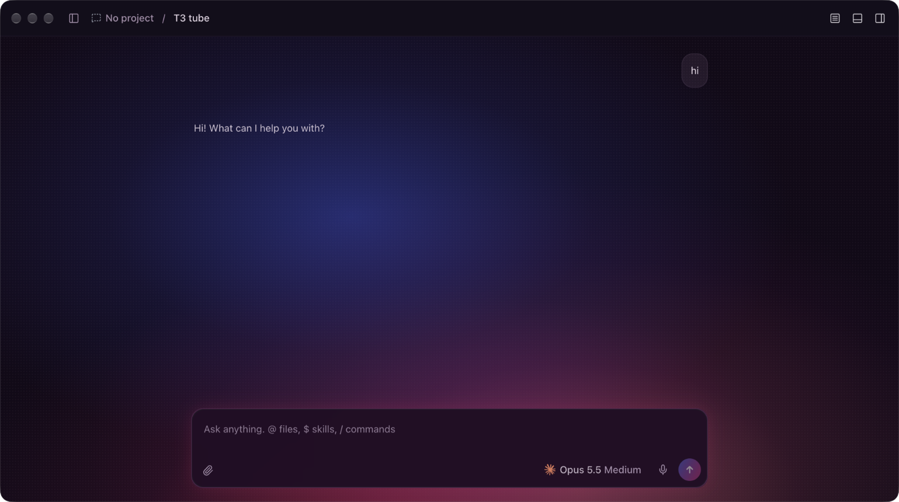
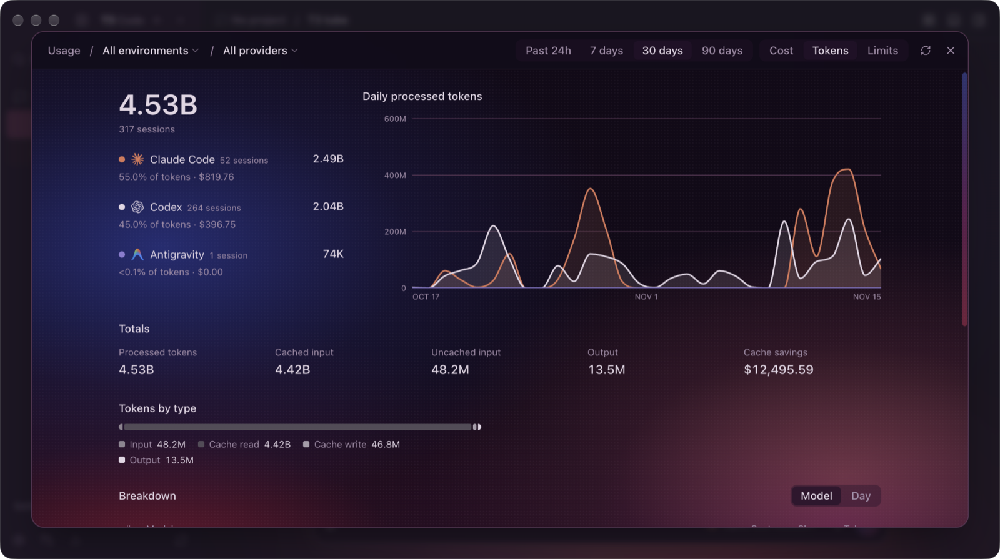

# T3 Nebula

A drifting-nebula dark theme for T3 Code. One file, no fork.

Built entirely on T3 Code's theme system (~15k of the 20k-character CSS limit).



## What changes

- **Living background**: blue, magenta, crimson and amber nebula clouds slowly drifting over a fine dot grid, in the chat, Usage and Settings pages
- **Glowing composer**: the input border cycles through the nebula palette; the send button is an animated gradient
- **Working state**: while the agent runs, the composer glow speeds up and "breathes", and the running thread shimmers in the sidebar
- **Usage shows what you've *used***: limit cards and the thread-details panel read `35% used` instead of `65% left`, bars fill from the left with the used part, and the even-pace tick is flipped to match
- **Glass panels**: thread details, Usage header and limit cards on frosted glass
- Nebula-tinted selection, focus rings, caret and scrollbars

## Preview



<sub>Dollar amounts on the Usage page are T3 Code's estimates at API prices, not an actual bill. These screenshots come from two $20/month subscriptions.</sub>

## Install

1. Download [`t3-nebula.json`](t3-nebula.json).
2. In T3 Code, open **Settings → Appearance** and click **Add a theme**.
3. Drop the file in (or paste its contents into **Theme JSON**), then pick **Nebula**.

Dark mode only.

## Customizing

The theme is generated by [`scripts/build_css.py`](scripts/build_css.py). Edit it and run:

```sh
python3 scripts/build_css.py t3-nebula.json
```

## Notes

- Tested on T3 Code Nightly `0.1.10-nightly.20261115`. The theme styles the app through its internal attributes, so a T3 Code update may break a piece or two. If something looks off, open an issue.
- "Used" percentages are computed in pure CSS (counters keyed on the bars' accessible labels); hover tooltips still say "left".
- Unofficial. Not affiliated with T3.

## License

MIT
